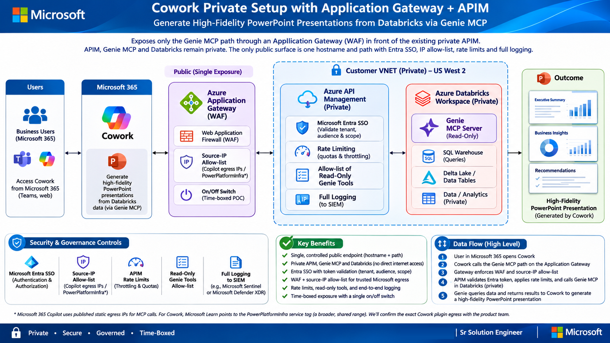
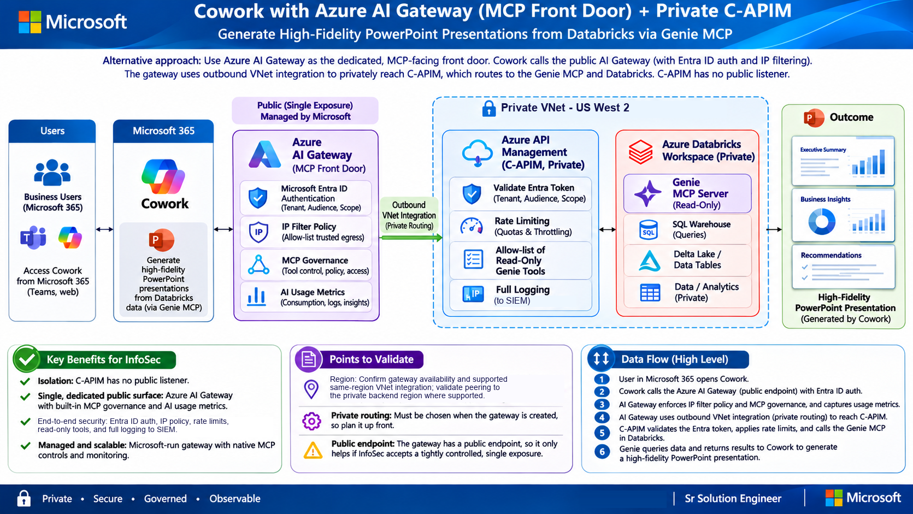

# Cowork: potential architectures for private Databricks Genie MCP

Two connectivity options for using Cowork to query private Azure Databricks
through Genie MCP and generate high-fidelity PowerPoint presentations. Both add
a controlled public front door while keeping the existing Azure API Management
(APIM), Genie MCP, and Databricks backend private.

**Status: architecture proposals, not deployed or validated configurations.**
This document synthesizes the two supplied architecture diagrams and the
accompanying technical discussion. The PNG diagrams below have identifying
labels removed. Email correspondence is not reproduced.

## Table of contents

- [Why a separate Cowork path is needed](#why-a-separate-cowork-path-is-needed)
- [What stays unchanged](#what-stays-unchanged)
- [Option 1: Application Gateway WAF in front of private APIM](#option-1-application-gateway-waf-in-front-of-private-apim)
- [Option 2: Azure AI Gateway as the MCP front door](#option-2-azure-ai-gateway-as-the-mcp-front-door)
- [Comparison and selection](#comparison-and-selection)
- [Shared security and data-handling requirements](#shared-security-and-data-handling-requirements)
- [Proof-of-concept acceptance checklist](#proof-of-concept-acceptance-checklist)
- [Rollback](#rollback)
- [Related documentation](#related-documentation)

## Why a separate Cowork path is needed

The existing Copilot Studio agent uses a Managed Environment with Power Platform
VNet support to reach private APIM:

```text
Teams / Copilot Chat
  -> Copilot Studio Managed Environment
  -> Power Platform VNet
  -> private APIM
  -> private Genie MCP / Databricks
```

Cowork plugin or remote MCP connectivity must be validated independently. It does
not automatically inherit the Copilot Studio environment's private network path.
Packaging or republishing an agent alone does not establish that connectivity.
For these proposals, the working assumption is that Cowork needs a
service-reachable MCP endpoint.

Agent availability, network reachability, and backend token exchange are separate
checks. Republishing and clearing a client cache can resolve some channel
visibility issues, but cannot create a route to private APIM. A reported
workspace-first-sign-in prerequisite for Databricks token exchange also needs
separate investigation; neither front-door option resolves it by itself.

## What stays unchanged

The intended invariants for both options are:

- **Existing APIM remains private:** retain its current private ingress model,
  with no public listener. Do not enable APIM public access or migrate its
  networking mode as part of this proposal.
- **Existing APIs remain unchanged:** isolate any new routing, token validation,
  and tool restrictions to the dedicated Genie MCP API. Check policy inheritance
  before changing a route shared with current callers.
- **Genie MCP and Databricks remain private:** neither receives direct internet
  ingress. Preserve Unity Catalog grants and existing data permissions.
- **Copilot Studio keeps its current route:** Teams and Copilot Chat continue
  through the Power Platform VNet, independently of the Cowork front door.
- **Source data remains in Databricks:** the architecture does not require
  replicating tables to a new data store. Query results still travel to Cowork
  for processing and presentation generation; this is not a guarantee of
  zero data egress or zero service-side retention.

These are design constraints to prove during validation, not assurances that
adding a public entry point leaves the overall security posture identical.

## Option 1: Application Gateway WAF in front of private APIM

### Architecture



```text
Microsoft 365 user -> Cowork
                       |
                       | HTTPS: dedicated hostname + Genie MCP path
                       v
              Application Gateway WAF
              Public listener; source-IP restrictions
                       |
                       | Private backend connectivity
                       v
                  Private APIM
              Entra token validation; authorization
              Rate limits; read-only tool allow-list; audit logs
                       |
                       v
              Private Genie MCP / Databricks
                       |
                       +-> Results return through the gateways to Cowork
                           -> PowerPoint presentation
```

### How it works

1. A user opens Cowork and invokes the configured remote MCP integration.
2. Cowork calls a dedicated HTTPS hostname and permitted Genie MCP path on
   Application Gateway. Other paths must be denied rather than forwarded.
3. The edge applies WAF inspection and source-IP restrictions for the verified
   Cowork service egress ranges.
4. Application Gateway forwards the permitted request to APIM over a private
   network route. Configure backend DNS, TLS hostname validation, and health
   probes without publishing unrelated APIM APIs.
5. APIM validates the Entra access token's issuer/tenant, audience, and required
   scopes or roles; enforces authorization, quotas, and the read-only tool
   allow-list; and calls the private Genie backend.
6. Results return along the same route. Cowork uses the approved results to
   generate the presentation.

### Why consider it

- Reuses an established Application Gateway edge pattern where one exists.
- Provides explicit hostname/path routing, WAF controls, and a time-boxed
  proof-of-concept entry point.
- Keeps MCP/backend policy enforcement centralized in private APIM.

### What must be validated

- Cowork's actual source egress ranges. Do not assume Microsoft 365 Copilot static
  IPs apply to Cowork. The diagram identifies `PowerPlatformInfra` as a possible
  broader shared range, not a confirmed workload-specific identity boundary.
  Verify whether service tags are supported at the chosen enforcement layer.
- MCP transport behavior through WAF and both gateways, including discovery,
  tool calls, streaming where required, response sizes, and timeout settings.
- Private connectivity from the Application Gateway subnet to APIM, including
  DNS, routing, NSGs, certificates, and probes.
- The shutdown mechanism for the dedicated listener or route. Avoid disabling a
  shared gateway or disrupting other applications.

## Option 2: Azure AI Gateway as the MCP front door

### Architecture



```text
Microsoft 365 user -> Cowork
                       |
                       | HTTPS + Entra authentication
                       v
              Azure AI Gateway front door
              Public endpoint; IP filtering
              Proposed MCP governance and usage metrics
                       |
                       | Outbound VNet integration / private routing
                       v
                  Private APIM
              Token validation; authorization; rate limits
              Read-only tool allow-list; audit logs
                       |
                       v
              Private Genie MCP / Databricks
                       |
                       +-> Results return through the gateways to Cowork
                           -> PowerPoint presentation
```

### How it works

1. Cowork calls the public MCP-facing AI gateway with an Entra access token.
2. The front door authenticates and authorizes requests, filters source IPs, and
   applies the MCP governance and usage monitoring supported by the selected
   service and configuration.
3. Outbound VNet connectivity allows the gateway to resolve and reach private
   APIM without enabling an APIM public listener.
4. APIM independently validates the intended token contract, applies backend
   authorization and rate limits, and permits only approved read-only Genie tools.
5. APIM calls private Genie MCP in Databricks. Results return through both
   gateways to Cowork for presentation generation.

### Why consider it

- Adds an AI/MCP-oriented governance layer that could serve future integrations.
- Separates the service-facing MCP entry point from existing private API
  management.
- Can provide centralized AI usage visibility if supported by the selected
  gateway offering.

### What must be validated

- **Exact product, tier, and lifecycle status:** "Azure AI Gateway" is the label
  in the proposal, not a deployment specification. Confirm whether the selected
  offering is APIM-based, whether it requires a separate gateway instance, and
  which MCP governance and metrics capabilities it actually supports.
- **Region and networking:** the diagram assumes outbound integration into a
  VNet in the gateway's region. Validate that requirement, gateway availability,
  and connectivity to the private backend region. Peering may be an option
  where supported; it does not remove a same-region integration requirement.
- **Creation-time choices:** confirm whether private routing must be selected
  when the gateway is created, as flagged in the diagram.
- **Token handling:** define the token audience at each hop and whether a token
  is forwarded or exchanged. Do not assume a token accepted by one gateway is
  valid for another or for Databricks.
- **Public exposure:** this option still has a public front door. It is not a
  fully private Cowork-to-backend path and requires explicit security approval.

## Comparison and selection

| Consideration | Option 1: Application Gateway WAF | Option 2: AI gateway front door |
|---|---|---|
| Public entry point | Dedicated HTTPS listener and MCP path | Dedicated public MCP gateway endpoint |
| Private backend hop | Application Gateway to APIM | Gateway outbound VNet route to APIM |
| Main strength | Familiar edge/WAF pattern and narrow routing | Potential reusable MCP governance and AI metrics |
| Main dependency | Edge routing, WAF/MCP compatibility, verified egress | Confirmed product capabilities, tier, region, and private routing |
| MCP authorization | Primarily private APIM and backend | Front-door controls plus independent private APIM/backend enforcement |
| Operational cost | Edge listener, certificates, WAF tuning, logging | Additional gateway, networking, policy, and monitoring lifecycle |
| Best fit | A bounded POC using an established edge platform | A broader AI gateway strategy with validated capabilities |

Prefer Option 1 for evaluation when the existing edge platform can satisfy the
MCP requirements with minimal change. Consider Option 2 when reusable MCP
governance and AI observability justify another gateway layer and its capabilities
are confirmed. Neither is an approved production design by default.

If policy prohibits **any** public service-reachable front door, neither proposal
meets that requirement. Retain the current private Copilot Studio route and
validate a supported Cowork private-connectivity alternative before proceeding.

## Shared security and data-handling requirements

- **Network filtering is not user authorization.** Shared Microsoft egress ranges
  can include other tenants; combine filtering with Entra tenant, application,
  audience, scope/role, and user authorization checks as applicable.
- **CORS is not an ingress security boundary.** It constrains browser behavior,
  not server-to-server MCP callers. Do not use CORS allowed origins as a
  substitute for network filtering or token validation.
- **Keep backend identity semantics explicit.** User authentication at APIM does
  not by itself establish delegated Databricks access. Preserve the approved
  backend identity/OBO design and prove Unity Catalog enforcement for each user.
- **Enforce read-only behavior server-side.** Restrict tool discovery and
  invocation, and use least-privilege Databricks grants. Prompts or tool names
  alone do not prevent writes or unauthorized reads.
- **Log for investigation, not data collection.** Send correlated access,
  authorization, tool, latency, throttling, and error events to the approved
  SIEM. Redact access tokens, secrets, and sensitive query/result payloads.
- **Approve the result-processing boundary.** Review Cowork processing location,
  retention, generated-file storage, sharing, and applicable compliance controls.
  Private source storage does not mean returned results never leave the VNet.
- **Limit the POC.** Use approved data, a small authorized test group, explicit
  quotas, an expiry date, and an owner for disabling the dedicated route.

## Proof-of-concept acceptance checklist

- [ ] Confirm Cowork entitlement, plugin/connector support, publication, and
      availability to the intended test users independently of network access.
- [ ] Confirm the supported MCP transport, authentication flow, and exact egress
      ranges with the relevant product documentation or support team.
- [ ] Prove that the public route exposes only the intended MCP API, with
      unrelated hosts/paths and unauthorized sources rejected.
- [ ] Prove that APIM and Databricks remain unreachable directly from the
      internet and that gateway-to-backend resolution and routing are private.
- [ ] Reject missing, expired, wrong-tenant, wrong-audience, and insufficiently
      authorized tokens; verify the identity contract at each hop.
- [ ] Verify approved tool discovery and calls; reject unapproved tools and
      operations, including write attempts.
- [ ] Compare results for users with different data permissions and confirm
      that backend authorization is preserved.
- [ ] Validate discovery, representative queries, follow-ups, long-running calls,
      throttling, explicit errors, and a downloadable grounded presentation.
- [ ] Resolve or document the separate Databricks first-sign-in/token-exchange
      issue; do not treat successful network access as proof it is fixed.
- [ ] Verify correlated, redacted SIEM events and approved data retention.
- [ ] Regression-test existing Copilot Studio, Teams, and Copilot Chat access.
- [ ] Disable the dedicated route and prove Cowork ingress stops while existing
      private consumers continue working.

## Rollback

Disable the dedicated public listener/route for Option 1, or the dedicated
MCP-facing gateway route for Option 2. Revoke POC-specific connector access and
credentials where applicable, then remove only POC-specific policies and network
rules through the normal change process.

Verify that the existing private APIs and Copilot Studio route still work.
Rollback removes the additional ingress path; it does not erase previously
returned results, presentations, or retained logs. Apply the approved retention
and cleanup procedures to those artifacts.

## Related documentation

- [Main solution README and private-network walkthrough](../../README.md)
- [Phase 2: authentication and delegated access](../obo/README.md)
- [Deployed resources and verification status](../deployed-resources/README.md)
