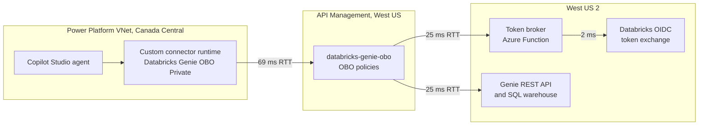
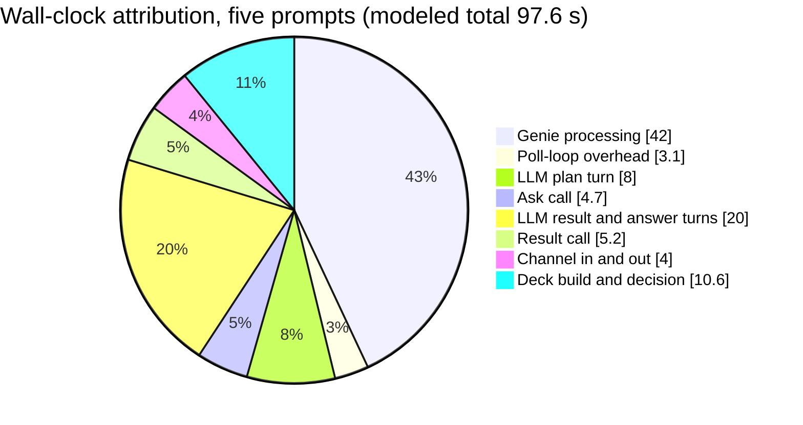

# Performance tuning: Copilot agent to Databricks Genie

This guide follows one question from a Copilot Studio agent, through the Power Platform
custom connector, the APIM OBO policies and token broker, and Databricks AI/BI Genie,
and back to the agent. It times each step for five end-to-end prompts, charts the
timelines, names the bottlenecks (including the cross-region network path), counts the
turns between the agent and Genie, and ranks the improvements.

> **Status: modeled, not measured.** This repository does not record per-hop latency.
> The OBO verification snapshot in [deployed resources](../deployed-resources/README.md)
> records outcomes and statement IDs, not timings, and the Copilot Studio and Power
> Platform hops cannot be timed from a repository checkout. Every value below comes from
> one model. Values are labeled **M** (published by Microsoft or set in this repository)
> or **A** (planning assumption). Replace the **A** values using
> [Measure it in your environment](#measure-it-in-your-environment) before you act on the
> ranking.

---

## Contents

- [Scope and status](#scope-and-status)
- [Executive summary](#executive-summary)
- [1. Request path](#1-request-path)
  - [Hop inventory](#hop-inventory)
  - [Region map and network latency](#region-map-and-network-latency)
  - [Limits and timeouts in this repository](#limits-and-timeouts-in-this-repository)
- [2. How the timings were built](#2-how-the-timings-were-built)
  - [Model parameters](#model-parameters)
  - [Measure it in your environment](#measure-it-in-your-environment)
- [3. Cost of one Genie call](#3-cost-of-one-genie-call)
- [4. Five end-to-end requests](#4-five-end-to-end-requests)
  - [Request summary](#request-summary)
  - [R1. Ranked revenue by region](#r1-ranked-revenue-by-region)
  - [R2. Smoke-test revenue by region](#r2-smoke-test-revenue-by-region)
  - [R3. Revenue chart and PowerPoint](#r3-revenue-chart-and-powerpoint)
  - [R4. 2025 sales by region](#r4-2025-sales-by-region)
  - [R5. Follow-up in the same conversation](#r5-follow-up-in-the-same-conversation)
- [5. Charts](#5-charts)
  - [Where the wall-clock time goes](#where-the-wall-clock-time-goes)
  - [Per-prompt split: before Genie, Genie window, after Genie](#per-prompt-split-before-genie-genie-window-after-genie)
  - [Expected effect of each lever](#expected-effect-of-each-lever)
- [6. Bottlenecks](#6-bottlenecks)
  - [Network latency: Canada Central, West US, West US 2](#network-latency-canada-central-west-us-west-us-2)
- [7. Turns between the agent and Genie](#7-turns-between-the-agent-and-genie)
- [8. Suggested improvements](#8-suggested-improvements)
  - [Native Genie MCP comparison](#native-genie-mcp-comparison)
- [9. Genie or Copilot Studio](#9-genie-or-copilot-studio-choosing-the-path)
  - [Decision rule](#decision-rule)
  - [PowerPoint Designer and Microsoft Graph](#powerpoint-designer-and-microsoft-graph)
  - [Performance by scenario](#performance-by-scenario)
    - [A. All data in Databricks](#a-all-data-in-databricks)
    - [B. Build a deck](#b-build-a-deck)
    - [C. Answers from several systems](#c-answers-from-several-systems)
  - [Before you choose](#before-you-choose)
- [10. Validation plan](#10-validation-plan)
- [11. References](#11-references)

---

## Scope and status

- **Path covered.** The OBO connector path: Copilot Studio agent, then the Power Platform
  custom connector (`Databricks Genie OBO Private`), then APIM `databricks-genie-obo`
  with the OBO policies, then the token broker (Azure Function), then the Databricks token
  exchange, then the AI/BI Genie REST operations, then the SQL warehouse, and back.
- **Genie MCP.** The OBO path does not call the Genie MCP endpoint. It calls the four
  Genie REST operations listed in [docs/obo/README.md](../obo/README.md). The native Genie
  MCP route (APIM `dbx-native-genie-mcp`, shared managed identity, no OBO) is compared in
  [Native Genie MCP comparison](#native-genie-mcp-comparison).
- **Prompts.** R1 to R4 are prompts from the repository tests and docs. R5 is a
  representative follow-up, not a recorded prompt.
- **No changes.** No deployed resource, policy, or configuration was modified by this work.

## Executive summary

- **One prompt takes 15.5 to 28.5 s** in the nominal runs. The expected average over Genie
  timing variation is 19.9 s per prompt.
- **Genie's own processing is the largest piece:** 42.0 s of the 97.6 s total across the
  five prompts (43%).
- **Most of the rest is sequential LLM decisions.** The plan turn, the result decision, and
  the answer take 5.6 s per prompt, about 31% of R1. The poll decisions run inside Genie's
  processing window, so they cost calls and quota more than wall-clock time.
- **Cross-region network is real but small on the critical path.** The Power Platform VNets
  are in Canada Central, APIM is in West US, and Databricks is in West US 2. A Genie call
  crosses about 121 ms of network. Only the ask and result calls sit on the critical path, so
  the path adds about 0.25 s per prompt (about 1 to 2%). Co-locating every hop saves about
  0.3 s per prompt. A new TLS session per connector call would add about 0.4 s.
- **The environment geography needs confirming.** `config/deployment.json` labels the
  environment location `unitedstates` (line 139) but attaches a Canada network-injection
  policy and Canada VNets (lines 227 and 228). The setup guide maps `unitedstates` to
  `eastus` and `westus`. Confirm which is intended in the Power Platform admin center.
- **Polls use the same quota as real work.** The OBO limit is 30 calls per 60 seconds per
  user and it applies to every operation. In the model, 14 of 19 polls return `RUNNING`, and
  one four-question deck issued in parallel uses 28 of the 30 calls.
- **Largest levers** (expected change in the five-prompt total): Genie 30% faster, minus
  13%; one composite ask-and-wait tool call, minus 9%; LLM turns 0.6 s faster, minus 7%;
  independent deck questions issued in one turn, from 67 s to 20 s (nominal).
- **Genie or Copilot Studio.** If all data is in Databricks, Genie answers R1 in about 10 s, against about 18 s through the Copilot Studio OBO path. Choose Copilot Studio when the agent must build a deck or combine several systems. See [section 9](#9-genie-or-copilot-studio-choosing-the-path).

---

## 1. Request path

Each Genie call follows the same route. Responses return along the same hops.



### Hop inventory

| # | Hop | Component and source | Location | Protocol and identity | Limits and timeouts |
|---|---|---|---|---|---|
| 1 | Agent to connector | Copilot Studio agent (GitHub Copilot harness) invokes four actions bound to the OBO connector. Source: [connector/genie-connector-swagger.json](../../connector/genie-connector-swagger.json), [create-genie-obo-connector.ps1](../../scripts/create-genie-obo-connector.ps1) | Copilot Studio environment | OAuth 2.0 delegated user token (Entra) | Connector runtime limits, not set in this repository |
| 2 | Connector to APIM | Power Platform delegated subnet in `caldova-pp-vnet-canadacentral`, peered to the APIM VNet | Canada Central (per config) | HTTPS to the APIM private endpoint | 69 ms RTT (**M**) |
| 3 | APIM OBO policies | API policy [genie-obo-api-policy.xml](../../apim/policies/genie-obo-api-policy.xml): validate-jwt, allowlist, rate limit, audit, broker call, token swap. Operation policies (`genie-start`, `genie-followup`, `genie-message`, `genie-result`) only rewrite the URI | `caldova-apim-westus`, StandardV2 | JWT validation; APIM managed identity to broker | 30 calls per 60 s per user (**C**); broker wait 20 s (**C**) |
| 4 | APIM to broker | Azure Function `/api/exchange`, source [functions/genie-token-exchange](../../functions/genie-token-exchange/src) | West US 2 ([reference.bicepparam](../../bicep/genie-obo/reference.bicepparam) sets `westus2`) | HTTPS over private DNS | JWKS discovery 5 s (**C**); Function host 1 minute |
| 5 | Broker to Databricks token service | RFC 8693 exchange at `/oidc/v1/token`, [broker.ts](../../functions/genie-token-exchange/src/broker.ts). No `client_id`, no redirects, no token cache | `caldova-dbx-westus2` | Assertion forwarded unchanged | 10 s (**C**) |
| 6 | APIM to Genie REST | `start-conversation`, `messages` (poll), `query-result`, and follow-up | West US 2 | Exchanged user token in `Authorization` | No repository timeout beyond APIM defaults |
| 7 | Genie and SQL warehouse | AI/BI Genie space; serverless warehouse `caldova-serverless-2xs` ([config](../../config/deployment.json)) | West US 2 | Unity Catalog grants of the mapped user | SQL statement wait 50 s (**C**) |
| 8 | Return path | Same hops in reverse. Normal responses set `Cache-Control: no-store` | Same as forward path | Same | Included in each RTT |

### Region map and network latency

| Segment | Direction used in the model | P50 RTT (ms) | Basis |
|---|---|---:|---|
| Connector to APIM | Canada Central to West US | 69 (reverse 69) | **M**: [Microsoft Learn latency statistics](https://learn.microsoft.com/en-us/azure/networking/azure-network-latency), July 2026 dataset |
| APIM to broker, APIM to Genie | West US to West US 2 | 25 (reverse 24) | **M**: same source |
| Broker to Databricks | Same region (West US 2) | 2 | **A** |
| Reference only, not in the path | Canada Central to West US 2 | 64 | **M**: same source |

Notes:

- Directional values come from the Microsoft Learn P50 table. Latency is directional, so
  each direction uses its own value.
- The setup guide states that a Canada environment still reaches a West US APIM over global
  peering and that the Databricks and APIM regions are irrelevant to the Power Platform
  region choice ([docs/setup-guide.md](../setup-guide.md), geo table and the note after it).
  The model keeps that design.
- Each Genie call crosses 121 ms of network: 69 + 25 + 2 + 25. The Canada Central hop is
  57% of it.

### Limits and timeouts in this repository

| Limit | Value | Source |
|---|---|---|
| OBO calls per verified user | 30 per 60 s | [obo.reference.bicepparam](../../apim/obo.reference.bicepparam) lines 13 and 14; `apim.rateLimits.oboCalls` in [config](../../config/deployment.json) |
| APIM wait for the broker | 20 s | [obo.reference.bicepparam](../../apim/obo.reference.bicepparam) line 15 |
| Broker token exchange | 10 s | [bicep/genie-obo/reference.bicepparam](../../bicep/genie-obo/reference.bicepparam) line 17 |
| Broker JWKS discovery | 5 s | [bicep/genie-obo/reference.bicepparam](../../bicep/genie-obo/reference.bicepparam) line 16 |
| Function host | 1 minute | [docs/obo/README.md](../obo/README.md), errors and operational boundaries |
| Non-OBO Genie calls (Phase 1) | 30 per 60 s | `apim.rateLimits.genieCalls` in [config](../../config/deployment.json); [genie-api-policy.xml](../../apim/policies/genie-api-policy.xml) |
| Native Genie MCP route | 30 per 60 s, managed identity | [dbx-native-genie-mcp-policy.xml](../../apim/policies/dbx-native-genie-mcp-policy.xml) |
| Poll interval in the repository test script | 4 s | [scripts/test-genie.ps1](../../scripts/test-genie.ps1) line 27 |
| SQL statement wait | 50 s | `databricks.sqlWaitTimeoutSeconds` in [config](../../config/deployment.json) |
| Broker host plan | Always On is required; the demo capture shows it disabled | [docs/obo/README.md](../obo/README.md) lines 250 and 264 |

---

## 2. How the timings were built

The model walks each prompt step by step. Each Genie call is the sum of the hops in
[section 3](#3-cost-of-one-genie-call). The agent takes one LLM decision before each tool
call and one before the final answer. Genie processing starts when the ask reaches
Databricks and lasts T seconds, where T is set per prompt. The agent polls until a poll
sees `COMPLETED`.

Scenario deltas average over Genie time from T minus 1 s to T plus 1 s in 0.1 s steps,
21 runs per prompt. A single run is sensitive to phase: a poll cycle of about 2.4 s moves
the final poll by up to one cycle.

### Model parameters

| Parameter | Value | Basis | Source or note |
|---|---|---|---|
| Connector to APIM RTT | 69 ms | **M** | Microsoft Learn, Canada Central to West US |
| APIM to broker and APIM to Genie RTT | 25 ms each | **M** | Microsoft Learn, West US to West US 2 |
| Broker to Databricks RTT | 2 ms | **A** | Same region |
| Connector runtime | 175 ms outbound and 175 ms inbound per call | **A** | Not in repository; read the connector run history |
| APIM policy execution | 20 ms per call | **A** | validate-jwt, rate-limit-by-key, audit trace, send-request |
| Broker host and JWT checks | 12 ms per call | **A** | Warm worker; signing keys reused |
| Databricks token exchange | 180 ms per call | **A** | No token cache by design |
| Genie REST service time | ask 250 ms, poll 90 ms, result 350 ms, follow-up 300 ms | **A** | Measure per operation |
| Agent LLM decision turn | 1,600 ms | **A** | Before each tool call and before the deck build |
| Agent answer composition | 2,400 ms | **A** | Final answer from returned rows |
| Channel ingress and egress | 400 ms each | **A** | Copilot channel |
| Sandbox deck build | 9,000 ms | **A** | R3 only |
| Genie processing T | 6.0 to 11.0 s | **A** | Per prompt, see [section 4](#4-five-end-to-end-requests) |

What would change the ranking:

- **LLM turn time.** Each turn 0.6 s faster lowers the five-prompt total by about 7%. Each
  turn 0.9 s slower raises it by about 11%.
- **Genie processing.** A 30% change in Genie time moves the total by about 13%.
- **Connector runtime.** Each 200 ms per call moves the total by about 2%.
- **TLS behavior.** If each connector call opens a new TLS session, add about 0.4 s per
  prompt.

### Measure it in your environment

1. **Correlate.** Normal APIM responses carry `x-correlation-id`, set in the outbound
   section of [genie-obo-api-policy.xml](../../apim/policies/genie-obo-api-policy.xml).
   Early `return-response` paths do not set it. The APIM audit events
   ([genie-obo-audit-fragment.xml](../../apim/policies/genie-obo-audit-fragment.xml)) and the
   broker's `genie_token_exchange` event
   ([audit.ts](../../functions/genie-token-exchange/src/audit.ts)) share that correlation ID.
2. **Read `durationMs` correctly.** The APIM audit `durationMs` is `context.Elapsed`, which
   counts from the start of the request. It is cumulative, so per-stage time is the
   difference between consecutive events. The broker's `durationMs` is per call.
3. **Query per-operation latency** (APIM audit events, same schema as
   [docs/obo/README.md](../obo/README.md) section 6):

   ```kusto
   AppTraces
   | extend audit = parse_json(Message)
   | where TimeGenerated >= ago(7d)
   | where tostring(audit.event) == 'genie_request' and tostring(audit.stage) == 'request_completed'
   | summarize calls = count(),
               p50_ms = percentile(todouble(audit.durationMs), 50),
               p95_ms = percentile(todouble(audit.durationMs), 95)
             by operation = tostring(audit.operation), method = tostring(audit.method)
   | order by operation asc
   ```

   Broker latency per outcome:

   ```kusto
   AppTraces
   | extend audit = parse_json(Message)
   | where TimeGenerated >= ago(7d)
   | where tostring(audit.event) == 'genie_token_exchange'
   | summarize calls = count(),
               p50_ms = percentile(todouble(audit.durationMs), 50),
               p95_ms = percentile(todouble(audit.durationMs), 95)
             by outcome = tostring(audit.outcome)
   ```

4. **Time the client.** Run from a host inside the network, such as the jump VM in the
   configuration. The snippet times the ask and each poll. Get the credential from a secure
   store, and use the OBO bearer token for the OBO route. The response shape fallback for
   `message_id` is in [scripts/test-genie.ps1](../../scripts/test-genie.ps1).

   ```powershell
   $base = 'https://<apim-name>.azure-api.net/<api-path>'   # placeholder, no secrets in source
   $headers = @{ 'Ocp-Apim-Subscription-Key' = $key; 'Content-Type' = 'application/json' }
   $timer = [System.Diagnostics.Stopwatch]::StartNew()
   $ask = Invoke-RestMethod -Method POST -Uri "$base/genie/ask" -Headers $headers -Body (@{ content = $question } | ConvertTo-Json)
   "ask: $($timer.ElapsedMilliseconds) ms"
   do {
       Start-Sleep -Seconds 1
       $t0 = $timer.ElapsedMilliseconds
       $msg = Invoke-RestMethod -Method GET -Uri "$base/genie/conversations/$($ask.conversation_id)/messages/$($ask.message_id)" -Headers $headers
       "poll: $($timer.ElapsedMilliseconds - $t0) ms, status $($msg.status)"
   } while ($msg.status -notin 'COMPLETED', 'FAILED', 'CANCELLED')
   ```

5. **Read the agent trace.** Use the Copilot Studio test trace for LLM decision time per turn
   and the connector run history for connector runtime. These replace the **A** values for
   the agent and connector.
6. **Split APIM from backend time.** Use APIM gateway logs in resource-specific mode
   (`ApiManagementGatewayLogs`) to split total time from backend time, as described in
   [README.md](../../README.md#observability).

---

## 3. Cost of one Genie call

Each connector operation costs the same hops, with different Genie service times. The
matrix gives the time for each hop and each operation.

| # | Hop | Ask | Poll | Result | Follow-up | Basis |
|---|---|---:|---:|---:|---:|---|
| 1 | Connector runtime, outbound | 175 | 175 | 175 | 175 | **A** |
| 2 | Connector to APIM (Canada Central to West US) | 69 | 69 | 69 | 69 | **M** |
| 3 | APIM inbound and outbound policies | 20 | 20 | 20 | 20 | **A** |
| 4 | APIM to broker (West US to West US 2) | 25 | 25 | 25 | 25 | **M** |
| 5 | Broker host and two JWT verifications | 12 | 12 | 12 | 12 | **A** |
| 6 | Broker to Databricks token exchange (2 ms RTT + 180 ms service) | 182 | 182 | 182 | 182 | **A** |
| 7 | APIM to Genie (West US to West US 2) | 25 | 25 | 25 | 25 | **M** |
| 8 | Genie REST service time | 250 | 90 | 350 | 300 | **A** |
| 9 | Connector runtime, inbound | 175 | 175 | 175 | 175 | **A** |
| | **Total per call (ms)** | **933** | **773** | **1,033** | **983** | |
| | of which network (rows 2, 4, 6 RTT, 7) | 121 | 121 | 121 | 121 | |

Genie receives the request about 0.5 s into each call, after the broker exchange. The
hop-level timeline for one poll:

```mermaid
gantt
    title One poll call through the OBO path (ms from call start)
    dateFormat x
    axisFormat %L ms
    section Connector
    Connector runtime outbound :hp0, 0, 175ms
    Network connector to APIM :hp1, 175, 69ms
    section APIM and broker
    APIM policies :hp2, 244, 20ms
    Network APIM to broker :hp3, 264, 25ms
    Broker verify :hp4, 289, 12ms
    Network broker to Databricks :hp5, 301, 2ms
    section Databricks
    Token exchange :hp6, 303, 180ms
    Network APIM to Genie :hp7, 483, 25ms
    section Genie
    Genie REST poll :hp8, 508, 90ms
    Connector runtime inbound :hp9, 598, 175ms
```



---

## 4. Five end-to-end requests

Each request starts at the user's prompt (t = 0) and ends when the answer leaves the
channel. Times are nominal single runs at the nominal Genie time. Every step lists its
start and duration. Internal hops of each call are in [section 3](#3-cost-of-one-genie-call).

### Request summary

| ID | Prompt (verbatim) | Source | Turn type | Genie processing T (s) | Polls (RUNNING + COMPLETED) | Agent-to-connector round trips | LLM decision turns | End to end (s) |
|---|---|---|---|---:|---|---:|---:|---:|
| R1 | What was total revenue in USD millions by region? Return the top 5 regions. | `tests.geniePrompt` in [config](../../config/deployment.json) | New conversation: ask | 9.0 | 4 (3 + 1) | 6 | 7 | 17.9 |
| R2 | What was total revenue by region? | `tests.smokePrompt` | New conversation: ask | 6.0 | 3 (2 + 1) | 5 | 6 | 15.5 |
| R3 | Show total revenue in USD millions by region. Build a labeled bar chart in a PowerPoint named api-smoke-test.pptx. | `tests.apiPrompt` | New conversation: ask, then deck | 9.0 | 4 (3 + 1) | 6 | 8 | 28.5 |
| R4 | What were total 2025 sales by region, in USD millions? | [foundry/docs/obo/README.md](../../foundry/docs/obo/README.md) line 1140 | New conversation: ask | 11.0 | 5 (4 + 1) | 7 | 8 | 20.2 |
| R5 | Split that by quarter for the top three regions. | Representative follow-up on R4 (not recorded) | Same conversation: follow-up | 7.0 | 3 (2 + 1) | 5 | 6 | 15.5 |
| | **Total** | | | **42.0** | **19 (14 + 5)** | **29** | **35** | **97.6** |

### R1. Ranked revenue by region

Baseline. One ask, four polls (three returned `RUNNING`), one result. The wait window is
9.5 s: Genie's 9.0 s plus 0.5 s of poll overshoot. The agent spends 2.9 s before the ask
returns and 5.4 s after Genie completes.

| # | Step | Start (s) | Duration (ms) | End (s) |
|---|---|---:|---:|---:|
| 1 | Channel in | 0.000 | 400 | 0.400 |
| 2 | LLM plan and tool choice | 0.400 | 1,600 | 2.000 |
| 3 | Ask call (933 ms) | 2.000 | 933 | 2.933 |
| 4 | LLM poll decision 1 | 2.933 | 1,600 | 4.533 |
| 5 | Poll call 1, returns RUNNING (773 ms) | 4.533 | 773 | 5.306 |
| 6 | LLM poll decision 2 | 5.306 | 1,600 | 6.906 |
| 7 | Poll call 2, returns RUNNING (773 ms) | 6.906 | 773 | 7.679 |
| 8 | LLM poll decision 3 | 7.679 | 1,600 | 9.279 |
| 9 | Poll call 3, returns RUNNING (773 ms) | 9.279 | 773 | 10.052 |
| 10 | LLM poll decision 4 | 10.052 | 1,600 | 11.652 |
| 11 | Poll call 4, returns COMPLETED (773 ms) | 11.652 | 773 | 12.425 |
| 12 | LLM result decision | 12.425 | 1,600 | 14.025 |
| 13 | Result call (1,033 ms) | 14.025 | 1,033 | 15.058 |
| 14 | LLM answer | 15.058 | 2,400 | 17.458 |
| 15 | Channel out | 17.458 | 400 | 17.858 |

```mermaid
gantt
    title R1 modeled timeline, ms from prompt
    dateFormat x
    axisFormat %S s
    section Critical path
    Channel in :done, r1a, 0, 400ms
    LLM plan :r1b, 400, 1600ms
    Ask call :crit, r1c, 2000, 933ms
    LLM poll decision 1 :r1d, 2933, 1600ms
    Poll call 1 :crit, r1e, 4533, 773ms
    LLM poll decision 2 :r1f, 5306, 1600ms
    Poll call 2 :crit, r1g, 6906, 773ms
    LLM poll decision 3 :r1h, 7679, 1600ms
    Poll call 3 :crit, r1i, 9279, 773ms
    LLM poll decision 4 :r1j, 10052, 1600ms
    Poll call 4 :crit, r1k, 11652, 773ms
    LLM result decision :r1l, 12425, 1600ms
    Result call :crit, r1m, 14025, 1033ms
    LLM answer :r1n, 15058, 2400ms
    Channel out :done, r1o, 17458, 400ms
    section Databricks Genie
    Genie processing (async) :active, r1x, 2496, 9000ms
```



### R2. Smoke-test revenue by region

The shortest Genie work (6.0 s). Three polls. The result call still runs because Genie
returns a generated query.

| # | Step | Start (s) | Duration (ms) | End (s) |
|---|---|---:|---:|---:|
| 1 | Channel in | 0.000 | 400 | 0.400 |
| 2 | LLM plan and tool choice | 0.400 | 1,600 | 2.000 |
| 3 | Ask call (933 ms) | 2.000 | 933 | 2.933 |
| 4 | LLM poll decision 1 | 2.933 | 1,600 | 4.533 |
| 5 | Poll call 1, returns RUNNING (773 ms) | 4.533 | 773 | 5.306 |
| 6 | LLM poll decision 2 | 5.306 | 1,600 | 6.906 |
| 7 | Poll call 2, returns RUNNING (773 ms) | 6.906 | 773 | 7.679 |
| 8 | LLM poll decision 3 | 7.679 | 1,600 | 9.279 |
| 9 | Poll call 3, returns COMPLETED (773 ms) | 9.279 | 773 | 10.052 |
| 10 | LLM result decision | 10.052 | 1,600 | 11.652 |
| 11 | Result call (1,033 ms) | 11.652 | 1,033 | 12.685 |
| 12 | LLM answer | 12.685 | 2,400 | 15.085 |
| 13 | Channel out | 15.085 | 400 | 15.485 |

```mermaid
gantt
    title R2 modeled timeline, ms from prompt
    dateFormat x
    axisFormat %S s
    section Critical path
    Channel in :done, r2a, 0, 400ms
    LLM plan :r2b, 400, 1600ms
    Ask call :crit, r2c, 2000, 933ms
    LLM poll decision 1 :r2d, 2933, 1600ms
    Poll call 1 :crit, r2e, 4533, 773ms
    LLM poll decision 2 :r2f, 5306, 1600ms
    Poll call 2 :crit, r2g, 6906, 773ms
    LLM poll decision 3 :r2h, 7679, 1600ms
    Poll call 3 :crit, r2i, 9279, 773ms
    LLM result decision :r2j, 10052, 1600ms
    Result call :crit, r2k, 11652, 1033ms
    LLM answer :r2l, 12685, 2400ms
    Channel out :done, r2m, 15085, 400ms
    section Databricks Genie
    Genie processing (async) :active, r2x, 2496, 6000ms
```



### R3. Revenue chart and PowerPoint

Same Genie work as R1. After the result, the agent decides to build the chart and deck,
and the sandbox builds the file. The deck decision and build add 10.6 s after the result,
which is 37% of this prompt.

| # | Step | Start (s) | Duration (ms) | End (s) |
|---|---|---:|---:|---:|
| 1 | Channel in | 0.000 | 400 | 0.400 |
| 2 | LLM plan and tool choice | 0.400 | 1,600 | 2.000 |
| 3 | Ask call (933 ms) | 2.000 | 933 | 2.933 |
| 4 | LLM poll decision 1 | 2.933 | 1,600 | 4.533 |
| 5 | Poll call 1, returns RUNNING (773 ms) | 4.533 | 773 | 5.306 |
| 6 | LLM poll decision 2 | 5.306 | 1,600 | 6.906 |
| 7 | Poll call 2, returns RUNNING (773 ms) | 6.906 | 773 | 7.679 |
| 8 | LLM poll decision 3 | 7.679 | 1,600 | 9.279 |
| 9 | Poll call 3, returns RUNNING (773 ms) | 9.279 | 773 | 10.052 |
| 10 | LLM poll decision 4 | 10.052 | 1,600 | 11.652 |
| 11 | Poll call 4, returns COMPLETED (773 ms) | 11.652 | 773 | 12.425 |
| 12 | LLM result decision | 12.425 | 1,600 | 14.025 |
| 13 | Result call (1,033 ms) | 14.025 | 1,033 | 15.058 |
| 14 | LLM deck decision | 15.058 | 1,600 | 16.658 |
| 15 | Sandbox deck build | 16.658 | 9,000 | 25.658 |
| 16 | LLM answer | 25.658 | 2,400 | 28.058 |
| 17 | Channel out | 28.058 | 400 | 28.458 |

```mermaid
gantt
    title R3 modeled timeline, ms from prompt
    dateFormat x
    axisFormat %S s
    section Critical path
    Channel in :done, r3a, 0, 400ms
    LLM plan :r3b, 400, 1600ms
    Ask call :crit, r3c, 2000, 933ms
    LLM poll decision 1 :r3d, 2933, 1600ms
    Poll call 1 :crit, r3e, 4533, 773ms
    LLM poll decision 2 :r3f, 5306, 1600ms
    Poll call 2 :crit, r3g, 6906, 773ms
    LLM poll decision 3 :r3h, 7679, 1600ms
    Poll call 3 :crit, r3i, 9279, 773ms
    LLM poll decision 4 :r3j, 10052, 1600ms
    Poll call 4 :crit, r3k, 11652, 773ms
    LLM result decision :r3l, 12425, 1600ms
    Result call :crit, r3m, 14025, 1033ms
    LLM deck decision :r3n, 15058, 1600ms
    Sandbox deck build :r3o, 16658, 9000ms
    LLM answer :r3p, 25658, 2400ms
    Channel out :done, r3q, 28058, 400ms
    section Databricks Genie
    Genie processing (async) :active, r3x, 2496, 9000ms
```



### R4. 2025 sales by region

A date-filtered question with the longest Genie work (11.0 s). Five polls, with the largest
wait window (11.9 s).

| # | Step | Start (s) | Duration (ms) | End (s) |
|---|---|---:|---:|---:|
| 1 | Channel in | 0.000 | 400 | 0.400 |
| 2 | LLM plan and tool choice | 0.400 | 1,600 | 2.000 |
| 3 | Ask call (933 ms) | 2.000 | 933 | 2.933 |
| 4 | LLM poll decision 1 | 2.933 | 1,600 | 4.533 |
| 5 | Poll call 1, returns RUNNING (773 ms) | 4.533 | 773 | 5.306 |
| 6 | LLM poll decision 2 | 5.306 | 1,600 | 6.906 |
| 7 | Poll call 2, returns RUNNING (773 ms) | 6.906 | 773 | 7.679 |
| 8 | LLM poll decision 3 | 7.679 | 1,600 | 9.279 |
| 9 | Poll call 3, returns RUNNING (773 ms) | 9.279 | 773 | 10.052 |
| 10 | LLM poll decision 4 | 10.052 | 1,600 | 11.652 |
| 11 | Poll call 4, returns RUNNING (773 ms) | 11.652 | 773 | 12.425 |
| 12 | LLM poll decision 5 | 12.425 | 1,600 | 14.025 |
| 13 | Poll call 5, returns COMPLETED (773 ms) | 14.025 | 773 | 14.798 |
| 14 | LLM result decision | 14.798 | 1,600 | 16.398 |
| 15 | Result call (1,033 ms) | 16.398 | 1,033 | 17.431 |
| 16 | LLM answer | 17.431 | 2,400 | 19.831 |
| 17 | Channel out | 19.831 | 400 | 20.231 |

```mermaid
gantt
    title R4 modeled timeline, ms from prompt
    dateFormat x
    axisFormat %S s
    section Critical path
    Channel in :done, r4a, 0, 400ms
    LLM plan :r4b, 400, 1600ms
    Ask call :crit, r4c, 2000, 933ms
    LLM poll decision 1 :r4d, 2933, 1600ms
    Poll call 1 :crit, r4e, 4533, 773ms
    LLM poll decision 2 :r4f, 5306, 1600ms
    Poll call 2 :crit, r4g, 6906, 773ms
    LLM poll decision 3 :r4h, 7679, 1600ms
    Poll call 3 :crit, r4i, 9279, 773ms
    LLM poll decision 4 :r4j, 10052, 1600ms
    Poll call 4 :crit, r4k, 11652, 773ms
    LLM poll decision 5 :r4l, 12425, 1600ms
    Poll call 5 :crit, r4m, 14025, 773ms
    LLM result decision :r4n, 14798, 1600ms
    Result call :crit, r4o, 16398, 1033ms
    LLM answer :r4p, 17431, 2400ms
    Channel out :done, r4q, 19831, 400ms
    section Databricks Genie
    Genie processing (async) :active, r4x, 2496, 11000ms
```



### R5. Follow-up in the same conversation

Follow-up on R4's conversation. The agent calls the `follow-up` operation instead of
`ask`, reusing the conversation ID. Three polls, 7.0 s of Genie processing.

| # | Step | Start (s) | Duration (ms) | End (s) |
|---|---|---:|---:|---:|
| 1 | Channel in | 0.000 | 400 | 0.400 |
| 2 | LLM plan and tool choice | 0.400 | 1,600 | 2.000 |
| 3 | Follow-up call (983 ms) | 2.000 | 983 | 2.983 |
| 4 | LLM poll decision 1 | 2.983 | 1,600 | 4.583 |
| 5 | Poll call 1, returns RUNNING (773 ms) | 4.583 | 773 | 5.356 |
| 6 | LLM poll decision 2 | 5.356 | 1,600 | 6.956 |
| 7 | Poll call 2, returns RUNNING (773 ms) | 6.956 | 773 | 7.729 |
| 8 | LLM poll decision 3 | 7.729 | 1,600 | 9.329 |
| 9 | Poll call 3, returns COMPLETED (773 ms) | 9.329 | 773 | 10.102 |
| 10 | LLM result decision | 10.102 | 1,600 | 11.702 |
| 11 | Result call (1,033 ms) | 11.702 | 1,033 | 12.735 |
| 12 | LLM answer | 12.735 | 2,400 | 15.135 |
| 13 | Channel out | 15.135 | 400 | 15.535 |

```mermaid
gantt
    title R5 modeled timeline, ms from prompt
    dateFormat x
    axisFormat %S s
    section Critical path
    Channel in :done, r5a, 0, 400ms
    LLM plan :r5b, 400, 1600ms
    Follow-up call :crit, r5c, 2000, 983ms
    LLM poll decision 1 :r5d, 2983, 1600ms
    Poll call 1 :crit, r5e, 4583, 773ms
    LLM poll decision 2 :r5f, 5356, 1600ms
    Poll call 2 :crit, r5g, 6956, 773ms
    LLM poll decision 3 :r5h, 7729, 1600ms
    Poll call 3 :crit, r5i, 9329, 773ms
    LLM result decision :r5j, 10102, 1600ms
    Result call :crit, r5k, 11702, 1033ms
    LLM answer :r5l, 12735, 2400ms
    Channel out :done, r5m, 15135, 400ms
    section Databricks Genie
    Genie processing (async) :active, r5x, 2496, 7000ms
```



---

## 5. Charts

### Where the wall-clock time goes

Non-overlapping attribution across the five nominal runs (97.6 s). Genie processing is its
full window, and the poll-loop overhead is the rest of the wait window.



### Per-prompt split: before Genie, Genie window, after Genie

One block is 0.5 s. Legend: `░` before Genie (channel in, plan, ask call), `█` Genie
processing window, `▒` poll-loop overhead, `▓` after Genie (result decision, result call,
answer, channel out, and the deck for R3).

```text
R1  17.9 s  ░░░░░░██████████████████▒▓▓▓▓▓▓▓▓▓▓▓
R2  15.5 s  ░░░░░░████████████▒▒▓▓▓▓▓▓▓▓▓▓▓
R3  28.5 s  ░░░░░░██████████████████▒▓▓▓▓▓▓▓▓▓▓▓▓▓▓▓▓▓▓▓▓▓▓▓▓▓▓▓▓▓▓▓▓
R4  20.2 s  ░░░░░░██████████████████████▒▒▓▓▓▓▓▓▓▓▓▓▓
R5  15.5 s  ░░░░░░██████████████▓▓▓▓▓▓▓▓▓▓▓
```

Before Genie, the agent spends about 3 s. Everything after Genie completes adds about 5 s
for most prompts. Genie processing is the largest middle segment in every prompt. The poll
decisions and poll calls sit inside the Genie window, so they add API calls and quota
usage, but almost no wall-clock time.

### Expected effect of each lever

Expected five-prompt total, averaged over Genie timing variation. Baseline: 99.3 s, or
19.9 s per prompt. One block is 0.5% of the change.

```text
Scenario                                        Total (s)   Change     Per prompt   Bar
S6  Genie processing 30% faster                    86.4     -13.0%     -2.6 s       ██████████████████████████
S1  Composite ask-and-wait (1 s flow wait)         90.0      -9.3%     -1.9 s       ███████████████████
S10 LLM turns 0.6 s faster                         92.0      -7.3%     -1.5 s       ███████████████
S8  Native Genie MCP route (no broker)             94.4      -4.9%     -1.0 s       ██████████
S5  Exchanged token cached (security decision)     96.9      -2.4%     -0.5 s       █████
S11 Connector runtime 150 ms per call              97.0      -2.2%     -0.5 s       ████
S4  Co-locate connector, APIM, Databricks          97.9      -1.3%     -0.3 s       ███
S4a Connector VNet in the US pair                  98.6      -0.7%     -0.1 s       █
S3  Direct token policy (no broker)                99.3       0.0%      0.0 s
S12 New TLS session per connector call           101.3      +2.1%     +0.4 s       ░░░░
S10 LLM turns 0.9 s slower                       110.1     +10.9%     +2.2 s       ░░░░░░░░░░░░░░░░░░░░░░
Combined S1 + S4 + S6                             75.8     -23.6%     -4.7 s       ███████████████████████████████████████████████
```

---

## 6. Bottlenecks

Share of R1's 17.9 s (nominal run):

| Rank | Bottleneck | Time in R1 | Share | Evidence | Lever |
|---|---|---:|---:|---|---|
| 1 | Genie processing | 9.0 s | 50% | Async Genie model; agent loop in [api/app/m365.py](../../api/app/m365.py) line 233 | Space tuning, warm warehouse |
| 2 | Sequential LLM turns outside the Genie window: plan 1.6 s, result decision 1.6 s, answer 2.4 s | 5.6 s | 31% | Agent instructions in [api/app/catalog.py](../../api/app/catalog.py) line 130 | Composite flow; shorter answers |
| 3 | Connector runtime on ask and result, 2 x 350 ms | 0.7 s | 4% | **A**; not in repository | Lean schema; measure |
| 4 | Genie REST service time on ask and result | 0.6 s | 3% | **A** | Operation-level measurement |
| 5 | Token exchange on ask and result, 2 x 182 ms | 0.4 s | 2% | [broker.ts](../../functions/genie-token-exchange/src/broker.ts); no cache by design | Security-approved cache only |
| 6 | Cross-region network on ask and result, 2 x 121 ms | 0.24 s | 1% | **M**; see below | Align connector region pair; co-locate |
| 7 | Poll-loop overhead (average 1.2 s across Genie timings) | 0.5 s | 3% | Poll cadence set by agent turns | Server-side wait |
| 8 | Channel in and out | 0.8 s | 4% | **A** | Not controllable from the repo |
| | APIM and broker policy on ask and result | 0.06 s | <1% | **A** | Not a bottleneck |

Two items sit outside the R1 critical path but matter:

- **Deck build (R3).** The deck decision and sandbox build add 10.6 s, 37% of R3.
- **Cold broker.** The docs require Always On ([docs/obo/README.md](../obo/README.md) line 250),
  but the demo capture shows it disabled (line 264). A cold worker adds JWKS discovery of up
  to 5 s and host start time. APIM waits at most 20 s for the broker, so one slow call can
  fail a prompt.

### Network latency: Canada Central, West US, West US 2

The path is connector VNet (Canada Central), APIM (West US), and broker, Databricks, and
Genie (West US 2).

- **Per call:** 121 ms of network time: 69 ms connector to APIM, 25 ms APIM to broker, 2 ms
  broker to Databricks, and 25 ms APIM to Genie.
- **Critical path:** only the ask and result calls sit outside Genie's processing window.
  That is 242 ms per prompt, about 1.4% of R1. Across all 29 calls in the five prompts it is
  3.5 s, about 3.6% of total time.
- **Co-locating every hop** (2 ms per hop, as an assumption) saves 0.26 to 0.27 s per prompt,
  about 1.3 to 1.5%. With a fast Genie (T = 2 s), the same change saves 0.26 s of 11.3 s,
  about 2.3%.
- **Connector VNet in the US pair only:** saves about 0.14 s per prompt (0.7%).
- **New TLS session per connector call** adds 138 ms (two round trips) on the Canada hop.
  That is about 0.4 s per prompt, 2.1% of the total. Check connection reuse first.
- **Configuration mismatch.** The environment location is `unitedstates`
  ([config/deployment.json](../../config/deployment.json) line 139). The Power Platform
  network-injection policy and VNets are Canada
  (`powerPlatform.enterprisePolicyName`; regions at lines 227 and 228; see
  [deployed resources](../deployed-resources/README.md)). The repository's own rule is that
  the enterprise policy geo must match the environment geo
  ([README.md](../../README.md#key-design-decisions)). The setup guide maps `unitedstates` to
  `eastus` and `westus`. Confirm in the Power Platform admin center
  (Virtual Network policies) which geo is intended. If the environment is in the US geo,
  the Canada hop is the largest network term and should move.
- **Reliability over latency.** A cross-region hop that fails or retries costs more than its
  RTT. The broker wait is 20 s, the token exchange is 10 s, and the JWKS fetch is 5 s, so a
  slow hop can stall a prompt for seconds.

---

## 7. Turns between the agent and Genie

Definitions used here:

- **Agent-to-connector round trip:** one invocation of an action (ask, follow-up, poll, or
  result). Each one is one APIM request.
- **LLM decision turn:** one agent planning step before a tool call, before the deck build,
  or before the final answer.

| Prompt | Round trips today | LLM decision turns today | Polls returning RUNNING | Target round trips (composite) | Target LLM turns (composite) |
|---|---:|---:|---:|---:|---:|
| R1 | 6 | 7 | 3 of 4 | 1 | 2 |
| R2 | 5 | 6 | 2 of 3 | 1 | 2 |
| R3 | 6 | 8 | 3 of 4 | 1 | 3 |
| R4 | 7 | 8 | 4 of 5 | 1 | 2 |
| R5 | 5 | 6 | 2 of 3 | 1 | 2 |
| **Total** | **29** | **35** | **14 of 19** | **5** | **11** |

- Every prompt makes at least five round trips: one start, one to five polls, and one result.
  R5 follows up in the same conversation, so it uses the follow-up instead of ask.
- Most polls are wasted. The agent polls again about every 2.4 s, but Genie usually needs
  6 to 11 s. In the model, 14 of 19 polls return `RUNNING`. Each one is an APIM request that
  counts against the user's 30-call budget, and each decision costs an LLM turn.
- With a composite ask-and-wait flow, the agent makes one tool call per prompt, but the flow
  still sends the same requests to APIM. At a 1 s flow cadence the five prompts make about
  35 APIM requests instead of 29. Budget the quota for the requests, not for the agent calls.

---

## 8. Suggested improvements

Ordered by expected effect on the five-prompt total. Effects are modeled and use the
expected-value method in [section 2](#2-how-the-timings-were-built).

| # | Change | Expected effect | Effort | Trade-offs and owners |
|---|---|---|---|---|
| 1 | Make Genie faster: refine the space instructions, add trusted example SQL and metric views, keep `caldova-serverless-2xs` warm, and keep returned tables narrow | Genie 30% faster: -13% (-2.6 s per prompt) | Low to medium | Validate answers against golden questions from the Genie UI |
| 2 | Collapse ask, poll, and result into one agent tool call. Put the sequence in a Power Automate cloud flow with a bounded Until loop, a 1 s delay, and a count and timeout cap. The flow calls the same four OBO operations | -9% (-1.9 s per prompt); agent round trips 29 to 5; LLM turns 35 to 11; APIM requests about 29 to 35 | Medium to high | Flow run cost; quota plan for the extra requests; do not hold requests open in APIM or the broker (20 s and 60 s limits) |
| 3 | Shorten answers: cap rows (top N), limit answer length, and trim tool descriptions | Each LLM turn 0.6 s faster: -7% | Low | Less narrative detail in the answer |
| 4 | Stop counting polls against the per-user limit. Apply `rate-limit-by-key` to ask and follow-up only, or give polls a separate budget | No wall-clock change; avoids 429 retries (each retry adds an LLM turn of about 1.6 s) | Low | The counter is in the API-level policy ([genie-obo-api-policy.xml](../../apim/policies/genie-obo-api-policy.xml) line 34). Keep authentication and allowlist checks unchanged |
| 5 | Use the native Genie MCP route for shared-identity data | -4.9% (-1.0 s per prompt); no broker or token exchange | Medium | Shared managed identity, not OBO. Use only approved shared data ([README.md](../../README.md), Choosing the native or API-to-MCP route) |
| 6 | Align the connector VNet region pair with the environment geo (after confirming intent) | -0.7% (-0.1 s per prompt); more if each call opens a new TLS session | Low (configuration) | Canada may be intentional for data residency; confirm before changing |
| 7 | Co-locate APIM with Databricks and the broker in West US 2, or move Databricks and the broker to West US | Further -0.6% on top of item 6 | High (APIM redeploy) | Only with a planned redeploy |
| 8 | Cache the exchanged Databricks token per user for its lifetime | -2.4% (-0.5 s per prompt) | Medium | Conflicts with the documented no-cache rule ([docs/obo/README.md](../obo/README.md), sections 3 and 4). Requires a security decision |
| 9 | Use the direct token-exchange policy (no broker) | 0.0% (14 ms per call) | Medium | Choose for operations simplicity only. The broker is a second `ALLOWED_CLIENT_IDS` check ([broker.ts](../../functions/genie-token-exchange/src/broker.ts) line 84; [bicep/genie-obo/main.bicep](../../bicep/genie-obo/main.bicep) line 166) |
| 10 | Keep the broker warm: Always On, and confirm JWKS reuse | Avoids first-call delays (**A**: 1 to 3 s) | Low | Plan cost; the demo capture currently shows Always On disabled |
| 11 | Trim connector runtime: minimal schema, fewer response fields, one reused OAuth connection | -2.2% per 200 ms per call (about -0.5 s per prompt) | Low | None known; measure first |
| 12 | Issue independent questions in one turn. For a four-question deck, run the four asks, poll them together, then fetch the four results | Deck: 67 s to 20 s (nominal), LLM turns about 26 to 8 | Medium | 28 APIM requests within about 20 s. Raise the per-user budget or use item 4 for deck-heavy users |

### Native Genie MCP comparison

The native route (`https://<apim-name>.azure-api.net/dbx-native-genie-mcp/api/2.0/mcp/genie/<space-id>`)
skips the Power Platform connector, the broker, and the token exchange. APIM obtains a
Databricks token with its managed identity ([dbx-native-genie-mcp-policy.xml](../../apim/policies/dbx-native-genie-mcp-policy.xml)).

- **Modeled:** connector runtime 150 ms per call (**A**), no broker, no token exchange. The
  five-prompt total falls by 4.9% (about 1.0 s per prompt).
- **Turns:** the README validation expects both a query tool and a polling tool, so the turn
  pattern is similar until you measure it.
- **Identity:** all users share the managed identity's permissions. The native route does not
  meet a per-user requirement.

### Avoid

- Caching the exchanged token without a security decision.
- Removing the azp check at APIM or the broker's `ALLOWED_CLIENT_IDS` check.
- Holding APIM requests open for a long poll (the APIM broker wait is 20 s).
- Polling faster than the agent can use the answer. Every early poll costs quota.

---

## 9. Genie or Copilot Studio: choosing the path

Customers ask whether a question should go straight to Genie or through a Copilot Studio
agent. The answer depends on where the data is and what the agent must do. This section
gives the decision rule, then compares performance in each scenario. It uses the same method
as sections 2 to 8, so the same caveat applies: the timings are modeled, not measured.

### Decision rule

- **All data in Databricks: use Genie.** If every question can be answered from Unity Catalog
  tables in a Genie space, Genie is faster and simpler. Users ask in Databricks, or in an app
  that calls the Genie API directly. That path has no agent decisions, no connector, no APIM,
  and no token exchange. Azure Databricks evaluates data access with each user's own Unity
  Catalog permissions, so the per-user control that OBO adds to Copilot Studio is already
  present. Azure Databricks docs now call these objects Genie Agents. This guide keeps
  "Genie space" to match the API paths.
- **Agent must build a deck, or combine several systems: use Copilot Studio.** Copilot Studio
  can ground answers in SharePoint, OneDrive, Salesforce, ServiceNow, Azure SQL, public
  websites, and uploaded files. It can also call custom connectors and MCP tools, and it can
  build the .pptx in its sandbox. Genie reaches only Databricks data and does not produce decks.
- **Mixed case: Genie as one tool inside the agent.** This is the reference design. Use it when
  users must stay in Microsoft 365 or Teams and the agent also needs a deck or other systems.
  The cost is agent overhead: 17.9 s to answer R1, against 10.3 s for Genie direct.
- **Costs differ.** Agents on the GitHub Copilot harness use usage-based billing, and their
  turns can consume Copilot Credits
  ([Copilot Studio knowledge sources](https://learn.microsoft.com/en-us/microsoft-copilot-studio/agents-experience/knowledge-sources-overview)).
  Genie direct consumes no Copilot Credits. Its cost is Databricks compute.
- **Genie direct prerequisites.** Users need private network access to the workspace, because
  this reference disables public access on Databricks and APIM ([README](../../README.md)).
  Users also need CAN RUN on the space. Without it, Genie returns no rows
  ([setup guide, troubleshooting](../setup-guide.md)).

### PowerPoint Designer and Microsoft Graph

Correct the premise before you compare the options:

- **There is no server-side PowerPoint Designer API.** This repository's design decision is that
  Designer runs only in the PowerPoint client, reached through the add-in API, VBA, or COM
  ([README](../../README.md), Key design decisions).
- **The deck path builds the file.** The deck skill creates the .pptx with python-pptx in the
  GitHub Copilot harness sandbox and returns it for download
  ([SKILL.md](../../skills/executive-deck-builder/SKILL.md)). Section 4, R3, measures that path.
- **Graph stores and shares the file.** Upload the .pptx to OneDrive or SharePoint, then create
  a sharing link (Microsoft Graph v1.0, share a file with a link). Graph's Excel workbook API
  works on workbooks
  ([Working with Excel in Microsoft Graph](https://learn.microsoft.com/en-us/graph/api/resources/excel?view=graph-rest-1.0)).
  I found no Graph resource that adds or lays out PowerPoint slides.
- **Slide layout in the user's PowerPoint needs an Office.js add-in.** That code runs in the
  client, not in Copilot Studio.

### Performance by scenario

Times are nominal single runs with the parameters from section 2. R1 is the data question for
scenario A, and R3 is the deck for scenario B. "Data returned" means the result reached the
client or agent. "Answer visible" means the user sees the answer. For Genie direct, that adds a
0.3 s render. For Copilot Studio, it adds the narrative answer and channel egress.

#### A. All data in Databricks

| Option | Data returned (s) | Answer visible (s) | LLM decisions | Requests to Databricks | Identity | Notes |
|---|---:|---:|---:|---:|---|---|
| Genie direct (Genie UI or app) | 10.0 | 10.3 | 0 | 10: 1 ask, 8 polls at a 1 s gap, 1 result | Each user's Databricks sign-in | Table and SQL, no narrative |
| Copilot Studio, composite flow (target) | 12.8 | 15.6 | 2 | 7 through APIM | Per user (OBO) | [Section 8](#8-suggested-improvements), item 2 |
| Copilot Studio, native Genie MCP | 14.5 | 17.3 | 8 | 7 through APIM | Shared managed identity | [Section 8](#8-suggested-improvements), item 5 |
| Copilot Studio, OBO connector (today) | 15.1 | 17.9 | 7 | 6 through APIM | Per user (OBO) | Reference design, [section 4](#4-five-end-to-end-requests), R1 |

Across the five prompts, Genie direct answers in 8.0 to 12.6 s. The OBO path answers in 15.5 to
20.2 s, and R3 with its deck takes 28.5 s.

The gap comes from agent decisions, not from Genie. Genie processes R1 in 9.0 s. The direct path
adds about 1 s of round trips and polling. The OBO path adds seven LLM decisions (plan, four poll
decisions, result, answer), and 5.6 s of plan, result, and answer time falls outside Genie's
processing window ([section 6](#6-bottlenecks)).

The polling gap matters for direct clients too. With a 4 s gap, which is the repository test
script's cadence, Genie direct answers in 13.5 s over three polls. A client that goes through
APIM and polls every second makes about 10 calls per question. That uses the 30-call per-user
budget in about three questions a minute. Poll Genie over the private path, or use a 2 to 4 s
gap through APIM.

R1 timeline for the three options, nominal, in ms from the prompt:

```mermaid
gantt
    title R1 timeline for three options nominal, ms from the prompt
    dateFormat x
    axisFormat %S s
    section Genie direct
    Ask request :d1, 0, 314ms
    Genie processing async :active, d2, 32, 9000ms
    Poll loop 1 s gap 8 polls :d3, 314, 9232ms
    Result request :d4, 9546, 414ms
    Render answer :d5, 9960, 300ms
    section Copilot OBO today
    Channel in :done, o1, 0, 400ms
    LLM plan :o2, 400, 1600ms
    Ask call :crit, o3, 2000, 933ms
    Genie processing async :active, o4, 2496, 9000ms
    Poll loop with 4 LLM decisions :crit, o5, 2933, 9492ms
    LLM result and result call :crit, o6, 12425, 2633ms
    LLM answer :o7, 15058, 2400ms
    Channel out :done, o8, 17458, 400ms
    section Copilot composite target
    Channel in :done, c1, 0, 400ms
    LLM plan :c2, 400, 1600ms
    Ask call :crit, c3, 2000, 933ms
    Genie processing async :active, c4, 2496, 9000ms
    Flow loop with 5 polls :crit, c5, 2933, 8865ms
    Result inside flow :crit, c6, 11798, 1033ms
    LLM answer :c7, 12831, 2400ms
    Channel out :done, c8, 15231, 400ms
```



#### B. Build a deck

| Option | Time to link or download (s) | LLM decisions | Who builds the .pptx | Notes |
|---|---:|---:|---|---|
| Copilot Studio agent (today, R3) | 28.5 | 8 | Agent sandbox with python-pptx (9.0 s, A) | Conversational; returns a download card |
| Copilot Studio, plus save to SharePoint (add-on) | 31.4 | 9 | Same, plus a Graph upload and link (1.0 s, A) | About 3 s more for one extra tool step |
| Genie direct for data, plus a deck app | 20.0 | 0 | Your function with python-pptx (9.0 s, A), then a Graph upload and link (1.0 s, A) | Fastest, but you build and run the pipeline, and there is no agent |

For a fixed template with no conversation, the custom pipeline saves about 8.5 s. Choose
Copilot Studio when the agent must decide what to build during the conversation: layout
choices, follow-up questions, or data from several systems.

#### C. Answers from several systems

| Option | Time to answer (s) | Works? | Notes |
|---|---:|---|---|
| Genie alone | Not applicable | No | Reaches Databricks data only |
| Copilot Studio, Databricks plus one more source, called after the Genie answer | 21.3 | Yes | About 3.5 s per extra source (A) |
| Copilot Studio, Databricks plus two more sources, called one after another | 24.8 | Yes | Each extra source adds one LLM decision |
| Copilot Studio, extra sources called in the same turn as the Genie ask | 17.9, if the sources return within Genie's processing window (A) | Yes | Little added wall-clock time, but more tokens and tool calls |
| Knowledge sources (design-time grounding) | Not modeled | Yes | Measure retrieval time in the agent trace |

Each extra source is modeled as one LLM decision (1.6 s), one connector call (0.35 s), and one
source call (1.5 s). All three are assumptions. Measure them in the agent trace and against the
source systems before you rely on the numbers.

Overview, answer visible by option (nominal single runs; one block is 0.5 s):

```text
A1 Genie direct (UI or app)               █████████████████████ 10.3 s
A2 Copilot, composite flow (target)       ███████████████████████████████ 15.6 s
A3 Copilot, native Genie MCP              ███████████████████████████████████ 17.3 s
A4 Copilot, OBO connector (today)         ████████████████████████████████████ 17.9 s
B1 Genie direct + app deck pipeline       ████████████████████████████████████████ 20.0 s
B2 Copilot, deck in sandbox (today)       █████████████████████████████████████████████████████████ 28.5 s
C1 Copilot + 1 extra source (sequential)  ███████████████████████████████████████████ 21.3 s
C2 Copilot + 2 extra sources (sequential) ██████████████████████████████████████████████████ 24.8 s
```

### Summary

| If the question is | Use | Why (modeled, nominal) |
|---|---|---|
| Answered from Databricks tables, by users who can open Databricks | Genie direct | About 10 s to answer, no agent decisions, each user's own Unity Catalog permissions |
| Answered from Databricks tables, but users must stay in Microsoft 365 or Teams | Copilot Studio with Genie as a tool, using a composite flow | About 15.6 s, against 17.9 s today |
| A deck built during the conversation | Copilot Studio | 28.5 s including the download, with the agent choosing the layout |
| A deck with a fixed template and no conversation | Custom pipeline (Genie, python-pptx, Graph) | About 20 s, but you build and run it |
| Needs SharePoint, Salesforce, ServiceNow, or other systems | Copilot Studio | Genie cannot reach them. Each extra sequential source adds about 3.5 s |

### Before you choose

1. Run the same 20 questions through Genie direct and through the agent. Record data returned
   and answer visible for each.
2. Measure the client's poll gap and its route to the workspace.
3. Replace the assumed values (LLM decision 1.6 s, source call 1.5 s, deck build 9.0 s, Graph
   upload 1.0 s) with measurements from the agent trace and the source systems.
4. Confirm that each user has CAN RUN on the space and read access to the tables. Otherwise
   Genie returns no rows, and the timings do not represent a real answer.

---

## 10. Validation plan

1. **Baseline.** Run R1 to R5 ten times each in the current configuration, from the same
   client and time window. Record the per-operation p50 and p95 from the KQL in
   [section 2](#measure-it-in-your-environment), plus the APIM request count and any 429
   responses per prompt.
2. **Check the model.** Compare measured connector runtime, LLM turn time, and Genie time with
   the **A** values. Update the model before ranking changes.
3. **Change one lever at a time.** Start with items 1, 2, and 4 from section 8. Repeat the
   baseline runs after each change.
4. **Check answers.** Use golden questions from the Genie UI. Confirm the Genie-generated SQL
   and the rows match, and that the answer still cites them.
5. **Confirm quota.** For deck-heavy users, confirm that no prompt exceeds the per-user budget
   and that no 429 responses trigger retries.
6. **Roll back.** Keep the previous policy XML, flow version, and configuration values. Revert
   if p95 or answer accuracy regresses.

---

## 11. References

- Microsoft Learn: [Azure network round-trip latency statistics](https://learn.microsoft.com/en-us/azure/networking/azure-network-latency), P50 table, dataset dated July 30, 2026.
- Microsoft Learn: [Virtual network support overview for Power Platform](https://learn.microsoft.com/power-platform/admin/vnet-support-overview).
- Mermaid: [Gantt diagram syntax](https://mermaid.js.org/syntax/gantt.html) (date formats and `ms` durations).
- Repository: [docs/obo/README.md](../obo/README.md), [docs/setup-guide.md](../setup-guide.md),
  [apim/policies](../../apim/policies), [functions/genie-token-exchange/src](../../functions/genie-token-exchange/src),
  [config/deployment.json](../../config/deployment.json), [scripts/test-genie.ps1](../../scripts/test-genie.ps1).
- Microsoft Learn: [Create and manage a Genie Agent (Azure Databricks)](https://learn.microsoft.com/en-us/azure/databricks/genie-agents/set-up). Data access is evaluated with each user's own Unity Catalog permissions.
- Microsoft Learn: [Available knowledge sources for agents (Copilot Studio)](https://learn.microsoft.com/en-us/microsoft-copilot-studio/agents-experience/knowledge-sources-overview). Knowledge source types and usage-based billing.
- Microsoft Learn: [Working with Excel in Microsoft Graph](https://learn.microsoft.com/en-us/graph/api/resources/excel?view=graph-rest-1.0). Graph's Excel workbook API.
- Microsoft Graph v1.0: share a file with a link (driveItem createLink), used for deck sharing links in section 9.
- Microsoft Learn: PowerPoint JavaScript API, PowerPoint.Presentation class (Office Add-ins), the client-side slide API.
