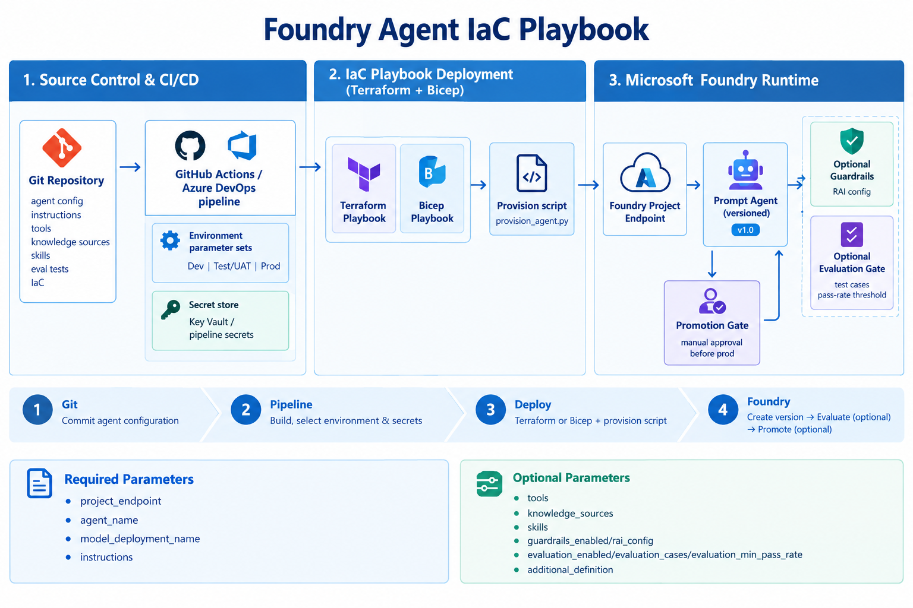

# Foundry Agent IaC Playbook (Terraform + Bicep)

Deploy and promote Foundry prompt agents from Git-managed definitions using reusable Infrastructure-as-Code playbooks.



## Table of contents

- [What this playbook provides](#what-this-playbook-provides)
- [Repository paths](#repository-paths)
- [Agent definition contract](#agent-definition-contract)
- [Terraform deployment flow](#terraform-deployment-flow)
- [Bicep deployment flow](#bicep-deployment-flow)
- [Optional guardrails and evaluations](#optional-guardrails-and-evaluations)
- [Notebook-style walkthrough](#notebook-style-walkthrough)
- [CI/CD promotion model (Dev → Test/UAT → Prod)](#cicd-promotion-model-dev--testuat--prod)
- [IaC best practices applied](#iac-best-practices-applied)
- [References](#references)

## What this playbook provides

- A **generic Terraform playbook**: [foundry/infra/agent-playbook/terraform/](../../infra/agent-playbook/terraform/)
- A **generic Bicep playbook**: [foundry/infra/agent-playbook/bicep/](../../infra/agent-playbook/bicep/)
- A **shared config-driven deploy script**: [foundry/infra/agent-playbook/scripts/provision_agent.py](../../infra/agent-playbook/scripts/provision_agent.py)
- Parameterization for:
  - Agent name
  - Instructions
  - Tools
  - Knowledge sources
  - Skills
  - Optional guardrails (`rai_config`)
  - Optional evaluation cases and pass-rate gates
  - Model deployment
  - Additional definition fields (temperature, metadata, response format, etc.)

## Repository paths

```text
foundry/
  infra/
    agent-playbook/
      scripts/provision_agent.py
      terraform/
        main.tf
        variables.tf
        outputs.tf
        versions.tf
        terraform.tfvars.example
      bicep/
        main.bicep
        main.bicepparam.example
```

## Agent definition contract

Both playbooks build this Foundry agent payload shape:

```json
{
  "project_endpoint": "https://<foundry-account>.services.ai.azure.com/api/projects/<project>",
  "agent_name": "sales-analyst-agent",
  "version_description": "Dev deployment",
  "definition": {
    "model": "<model-deployment-name>",
    "instructions": "You are a concise enterprise analyst...",
    "tools": [],
    "knowledge_sources": [],
    "skills": [],
    "temperature": 0.2
  }
}
```

This repository's Databricks Genie OBO MCP route can be used as a tool example:

```json
{
  "type": "mcp",
  "server_label": "databricks-genie-obo",
  "server_url": "https://<apim-name>.azure-api.net/dbx-native-genie-mcp/api/2.0/mcp/genie/<genie-space-id>",
  "project_connection_id": "<foundry-project-connection-name>",
  "require_approval": "never",
  "allowed_tools": []
}
```

## Terraform deployment flow

1. Start from [terraform.tfvars.example](../../infra/agent-playbook/terraform/terraform.tfvars.example).
2. Set environment-specific values.
3. Run:

```powershell
Set-Location .\foundry\infra\agent-playbook\terraform
terraform init
terraform apply
```

The module writes a generated config file and executes [provision_agent.py](../../infra/agent-playbook/scripts/provision_agent.py) to create a new immutable version.

## Bicep deployment flow

1. Start from [main.bicepparam.example](../../infra/agent-playbook/bicep/main.bicepparam.example).
2. Set environment-specific values.
3. Run:

```powershell
Set-Location .\foundry\infra\agent-playbook\bicep
az deployment group create `
  --resource-group <resource-group> `
  --template-file .\main.bicep `
  --parameters .\main.bicepparam
```

The Bicep template runs an Azure deployment script that provisions a new immutable agent version from parameters.

## Optional guardrails and evaluations

Guardrails and evaluation are fully optional in both playbooks.

### Terraform fields

- `guardrails_enabled` + `rai_config_json`
- `evaluation_enabled`
- `evaluation_cases_json`
- `evaluation_min_pass_rate`
- `evaluation_fail_on_error`

Example:

```hcl
guardrails_enabled = true
rai_config_json = jsonencode({
  # Put your Foundry RAI/guardrail object here
})

evaluation_enabled = true
evaluation_min_pass_rate = 0.8
evaluation_fail_on_error = true
evaluation_cases_json = jsonencode([
  {
    name = "grounding-check"
    prompt = "What can you help me analyze?"
    must_contain_any = ["analyze", "data", "query"]
    must_not_contain_any = ["I cannot help", "unknown"]
  }
])
```

### Bicep fields

- `enableGuardrails` + `raiConfig`
- `enableEvaluation`
- `evaluationCases`
- `evaluationMinPassRatePercent` (0-100)
- `evaluationFailOnError`

Example:

```bicep
param enableGuardrails = true
param raiConfig = {
  // Put your Foundry RAI/guardrail object here
}

param enableEvaluation = true
param evaluationMinPassRatePercent = 80
param evaluationFailOnError = true
param evaluationCases = [
  {
    name: 'grounding-check'
    prompt: 'What can you help me analyze?'
    must_contain_any: [
      'analyze'
      'data'
      'query'
    ]
    must_not_contain_any: [
      'I cannot help'
      'unknown'
    ]
  }
]
```

If evaluation is enabled and pass-rate is below threshold, deployment fails when the fail-on-error gate is true.

## Notebook-style walkthrough

For a demo notebook experience (for enterprise architecture and platform teams), run the same playbook commands as sequential notebook cells:

1. **Cell 1**: set environment variables and choose environment (`dev`, `test`, or `prod`).
2. **Cell 2**: generate or update playbook parameter files.
3. **Cell 3**: deploy with Terraform or Bicep.
4. **Cell 4**: execute a smoke prompt against the deployed agent.
5. **Cell 5**: archive deployment outputs and validation evidence.

This keeps a reviewable execution trail while preserving source-controlled IaC and agent definition assets.

## CI/CD promotion model (Dev → Test/UAT → Prod)

- Keep one source definition and separate per-environment parameter/secret stores.
- Use isolated Foundry projects per environment.
- Promote the same agent definition through environments using pipeline gates.
- Run smoke/evaluation checks before promoting to production.

### GitHub Actions / Azure DevOps pattern

1. Pull agent source and IaC from Git.
2. Inject environment-specific values from secure variable groups / secret stores.
3. Run Terraform or Bicep deployment stage.
4. Run agent smoke validation stage.
5. Require approval before production promotion.

## IaC best practices applied

- Keep the agent source/configuration, instructions, tool definitions, evaluation/tests, and infrastructure definitions in Git.
- Use separate Foundry projects/environments for Dev, Test/UAT, and Prod, with environment-specific endpoints, connection IDs, model deployments, and secrets kept outside the source definition.
- Use CI/CD in Azure DevOps or GitHub Actions to deploy/promote the agent to the target Foundry environment and run validation/smoke tests before production promotion.
- For hosted agents, use Azure Developer CLI (azd) CI/CD patterns with GitHub Actions or Azure DevOps, including Bicep or Terraform for infrastructure and pipeline-friendly agent deployment.

## References

### Microsoft Learn

- [Set up CI/CD for hosted agents with Azure Developer CLI](https://learn.microsoft.com/en-us/azure/foundry/agents/how-to/set-up-ci-cd-cli)
- [Hosted agent CI/CD quickstart](https://learn.microsoft.com/en-us/azure/foundry/agents/quickstarts/set-up-cicd-hosted-agent)

### GitHub samples

- [Microsoft Foundry samples](https://github.com/microsoft-foundry/foundry-samples)
- [Foundry Bicep infrastructure samples](https://github.com/microsoft-foundry/foundry-samples/tree/main/infrastructure/infrastructure-setup-bicep/)
